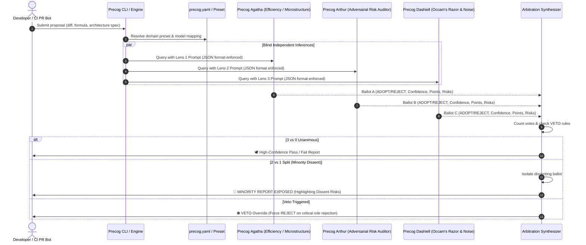

# 🏛️ Precog Council Architecture & Theoretical Foundations

This document details the internal mechanics, arbitration sequence, and design principles behind **Precog Council**.

---

## 📐 Conceptual Sequence: The Arbitration Loop

---

## 🎯 The Three-Lens Principle (Triangulation of Truth)

Why three? And why these specific three?

In epistemology and systems engineering, truth is robustly determined by triangulating from **mutually orthogonal perspectives**:

1. **Thesis (The Constructive Visionary - Agatha)**:
   - Evaluates the theoretical ideal, maximum scale, and structural potential.
   - Without Agatha, the team stagnates and refuses to innovate.
2. **Antithesis (The Adversarial Skeptic - Arthur)**:
   - Searches relentlessly for destructive failure modes, security loopholes, and fatal edge cases.
   - Without Arthur, systems collapse under production stress or malicious input.
3. **Synthesis / Occam (The Pragmatic Simplifier - Dashiell)**:
   - Strips away intellectual vanity, complex wrappers, and over-engineering.
   - Without Dashiell, systems drown in premature optimization and unmaintainable abstractions.

---

## ⚖️ Condorcet Jury Theorem & The Fallacy of Homogeneous Ensembles

The **Condorcet Jury Theorem** states that if each voter has a probability $p > 0.5$ of being correct independently, adding more voters drives the collective accuracy toward $1.0$.

However, in modern AI:
* **LLMs trained on the same data are NOT independent.** They share common blind spots, hallucinations, and alignment biases.
* Querying the same model 3 times with the same prompt yields correlated errors.

### Precog Council's Solution:
1. **Persona Decoupling**: Forcing each precog into a radically different cognitive posture (optimist vs. adversarial attacker vs. minimalist).
2. **Model Diversity**: Combining Google (Gemini/Argon), Anthropic (Claude/Opus), and OpenAI/open-source models.
3. **Elevating the Minority**: Instead of suppressing the 1-of-3 dissenter via majority rule, we treat the dissenter as the **canary in the coal mine**.
